  

<table>
<tr>
<td width="70%" valign="top">

I'm a **Full Stack Developer** & data student building complete digital products — from interface to backend logic.

I focus on clean **UI/UX**, solid **architecture**, and turning **data** into something useful.

I'm currently exploring **APIs, cloud deployment, and data visualization** to build more complete products. ♡

</td>
<td align="center" width="30%" valign="middle">

 
 

</td>
</tr>
</table>

<table>
<tr>
<td align="center" width="35%">

</td>
<td width="65%" valign="top">

**Achievements & Highlights ✦**

🏆 **2nd Place Winner — Digital Factory & AI Bootcamp (24h Hackathon)**  
Developed an industrial mobile app for **SuperBrix** to track shop-floor downtime in real time via voice logs and Groq NLP, replacing paper records with live Pareto dashboards.

🎓 **Education & Focus**  
Studying ADSO at **SENA** & 3rd semester **Software & Data Engineering** at **IU Digital**. Focused on **Machine Learning**, data analysis, and building full-stack products from UI to database.

</td>
</tr>
</table>

<table>
<tr>
<td width="42%" valign="top">

**✦ tech stack**

**Frontend** 
 
 

**Backend & Database** 
 
 

**Cloud, DevOps & Tools** 

</td>
<td width="58%" valign="top">

**✦ projects**

🛠️ **[Soportix](https://github.com/bleidys16/Soportix)**
Helpdesk empresarial con tickets y roles.
`Django REST` `Angular` `PostgreSQL` `JWT`

---

🏥 **[VITA-Clinical](https://github.com/bleidys16/VITA-Clinical)**
Gestión clínica con arquitectura CRUD.
`Django REST` `PostgreSQL` `Bootstrap` `scikit-learn`

---

🧠 **[Intellixy](https://github.com/bleidys16/Intellixy)**
Estudio con IA: quizzes, flashcards y tutor con citas desde tus PDF y apuntes. Web y Android.
`Next.js` `TypeScript` `PostgreSQL` `Capacitor`

[Descarga el APK en el repo](https://github.com/bleidys16/Intellixy)

---

📊 **[Analyzor](https://github.com/bleidys16/Analyzor)**
Análisis de CSV con visualizaciones y NLP.
`Python` `React` `Vite`

</td>
</tr>
</table>

<h3 align="center"><code>// github stats</code></h3>

  

<h3 align="center"><code>// spent my time</code></h3>

  

 

  💗 thanks for stopping by - let's build something — <a href="mailto:lariosbleidys@gmail.com">let's talk</a>

